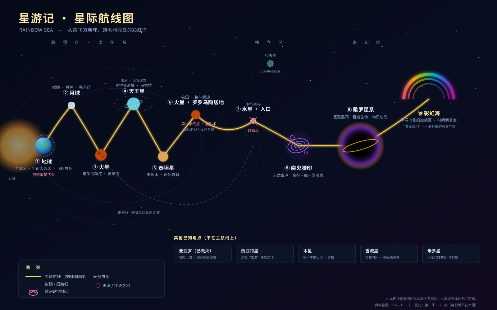

# 《星游记》设定资料库

> 为长篇同人小说创作而整理的《星游记》（Rainbow Sea）世界观、剧情、人物、地图全资料。
> 资料整理日期：2026-11-01

---

## 正史宣告

**本资料库的唯一底座：2011 年电视动画《星游记》第一季，全 26 集。**

| 作品 | 年份 | 本库处理 |
| --- | --- | --- |
| 《星游记》TV 第一季（1–26 集） | 2011 | **正史**。全部设定、人物、地理以此为准 |
| 《星游记之风暴法米拉》 | 2017 | **非正史**。设定与剧情封存于 [附录](附录/非正史资料-风暴法米拉与冲出地球.md) |
| 《星游记之风暴法米拉 2》 | 2020 | **非正史**。同上 |
| 《冲出地球》 | 2022 | **非正史**（平行宇宙改编）。同上 |
| 未播出的第 27 集及之后 | — | 官方空白，视为“我们的地盘” |

**为什么排除电影版**：它把“性格即能力、每次使用都要付代价”的彩虹石体系换成了竞技赛与战力膨胀，把“一个少年为了一个约定飞出去”换成了“一群人在综艺节目里争名次”。招牌还是那块招牌，卖的已经不是那份东西。所以——**不删除，隔离**：所有素材仍可查，但不得进入正文；若要借用结构，必须在 [10](设定集/10-原创设定与谜题库.md) 的 `R` 表登记。

---

## 这是什么

这不是一篇观后感，而是一套**可以直接当写作工具书用**的资料库。它分三层：

1. **考据层**（00–05、07、08）：官方到底说了什么，没说什么，哪些是粉丝脑补。
2. **裁决层**（09）：官方没回答的大坑，由我们判真判假，并规定由谁、在第几卷、以什么代价揭晓。
3. **创作层**（06、10）：怎么把这些东西写成小说；我们新加了哪些设定、谜题、角色。

- 写小说前查设定 → [01 世界观总纲](设定集/01-世界观总纲.md)
- 想回忆原作发生了什么 → [02 剧情全解](设定集/02-剧情全解.md)
- 要写某个人物、怕 OOC → [03 人物图鉴](设定集/03-人物图鉴.md)
- 要安排航线、写新星球 → [04 星际地图与地点](设定集/04-星际地图与地点.md)
- 怕踩到原作没解释的坑 → [05 官方谜题与设定辨析](设定集/05-未解之谜与考据.md)
- 准备动笔、要大纲和方法 → [06 小说创作手册](设定集/06-小说创作手册.md)
- 想核实某句话的出处 → [07 资料索引](设定集/07-资料索引.md)
- 写作时贴在旁边 → [08 速查卡](设定集/08-速查卡.md)
- 想知道“官方没说的那些，我们怎么定” → [09 正史裁决书](设定集/09-正史裁决书.md)
- 想知道“哪些是我们自己加的” → [10 原创设定与谜题库](设定集/10-原创设定与谜题库.md)

---

## 三十秒速览

| 项目 | 内容 |
| --- | --- |
| 一句话故事 | 十年前，“红魔鬼”麦林宣称黑洞深处有能实现任何愿望的“彩虹海”，带走了全宇宙的冒险者，无一归来。十年后，他的儿子麦当拉钩起誓，要飞出禁飞的地球，去证明那不是谎言。 |
| 主角团 | 麦当（厨师／彩虹石自由者）、咕咚·萌西（亡国国王／兔子）、笛亚（最后的星学家）、米龙二代（画家／八极天格斗家） |
| 核心道具 | 彩虹石、黄金魔方、乌拉拉、国王号、空气接收器 |
| 三大势力 | 银河眼（垄断性巨型集团／实际统治者）、星际联盟（星系政府联合体／合法秩序）、黑旗（太空海盗） |
| 关键地理 | 地球 → 月球 → 火星·黄泉湾 → 天王星 → 泰坦星 → 火星·罗罗乌 → 魔鬼脚印 → 歌罗星系 → 彩虹海 |
| 力量体系 | 彩虹石按持有者性格赋予能力，分强化系／契约系／灵力系；另有八极天格斗术、罗罗乌战神兵器、纯科技装备 |
| 母题 | 谎言与相信、约定、父子、家、在绝望里点灯的人 |
| 本作裁决 | 彩虹海是账本不是奖品；蔓影术是封存术；彩虹石是尤纳斯人的遗骸；麦林活着且不肯回来；银河眼是对的但把人当数字 |

---

## 目录

### [00 导读与资料说明](设定集/00-导读与资料说明.md)
怎么用这套资料；正史宣告；四问（哪些是真的、哪些是编的、哪些是我们定的、哪些还没定）；分级标注规则。

### [01 世界观总纲](设定集/01-世界观总纲.md)
宇宙结构（联盟区／独立区／未知区）、历史年表、彩虹石与自由者体系、科技与道具、各方势力、社会生态，以及“必须守住的 10 条世界规则”。

### [02 剧情全解](设定集/02-剧情全解.md)
第一季 26 集逐集详解（地点／剧情／写作钩子），附未影视化的第二季传闻与同人可插入的时间缝隙。

### [03 人物图鉴](设定集/03-人物图鉴.md)
按阵营编排：主角团、银河眼（五色眼／经理人／杂兵）、星际联盟、星学会、黑旗与海盗、罗罗乌族、八极天、地球众生。每人含身份、外形、性格、能力招式、经历、台词、写作提示。

### [04 星际地图与地点](设定集/04-星际地图与地点.md)
航线图（另附 [SVG 星图](assets/星游记星图.svg)）、每个地点的时间与剧情功能、可扩展的空白地带。

### [05 官方谜题与设定辨析](设定集/05-未解之谜与考据.md)
官方没填的坑、设定冲突（年龄、彩虹石分类、辛夕娅／辛西娅、通行条件）、粉丝推测与正典层级表。**只列问题，不做裁决。**

### [06 小说创作手册](设定集/06-小说创作手册.md)
叙事位置选择、人物声线、原创角色模板、战斗写法、节奏表、三卷本大纲、开篇示范、13 条禁忌。

### [07 资料索引](设定集/07-资料索引.md)
逐条来源与可信度评级（含电影版条目的“非正史”标注）。

### [08 速查卡](设定集/08-速查卡.md)
26 集一行一览、人物一句话档案、术语表、关键数字、五条不可反悔、原创设定速记——写作时贴在旁边的那一页。

### [09 正史裁决书](设定集/09-正史裁决书.md)
13 条大命题的判真／判假、揭晓者、卷次与代价；揭晓节奏表；五条不可反悔；裁决之后仍可自由发挥的清单。

### [10 原创设定与谜题库](设定集/10-原创设定与谜题库.md)
原创设定登记（星图竞逐、公告网、沉船斗技场、赏金猎人、星图贩子、熵化型彩虹石、穹顶殖民、影子领域）、12 条原创谜题、5 个原创角色、电影零件回收表。

### [附录 非正史资料](附录/非正史资料-风暴法米拉与冲出地球.md)
《风暴法米拉》1–2 与《冲出地球》的设定、剧情、人物留存，“不采用理由”对照表，以及“可回收零件”清单。**只作档案，不作正典。**

---

## 一张图看懂航线

> 地球是“起点”，月球是“同伴”，天王星是“钥匙”，罗罗乌是“人”，魔鬼脚印是“门”，歌罗星系是“深渊”，彩虹海是“答案”——但那个答案是一本账。

---

## 使用约定

- **【正史】** 第一季 26 集明确出现的内容。
- **【整理】** 百科／维基／粉丝 Wiki 汇总，来源可靠但非一手。
- **【推测】** 粉丝推断或二创惯例，可作灵感，不是正典。
- **【原创】** 本库新增的设定、谜题、角色，全部登记在 [10](设定集/10-原创设定与谜题库.md)。
- 所有存疑处在正文用 `⚠️` 标出；与电影版相关的内容一律移入 [附录](附录/非正史资料-风暴法米拉与冲出地球.md)，不进正文。
- 遇冲突，优先级：**第一季正片 > 官方设定解说/采访 > 百科 > 粉丝考据 > 电影版（仅作传闻）**。

祝下笔如有神。愿你的故事里，也有人愿意为一句拉过勾的话，飞过整片黑暗。
